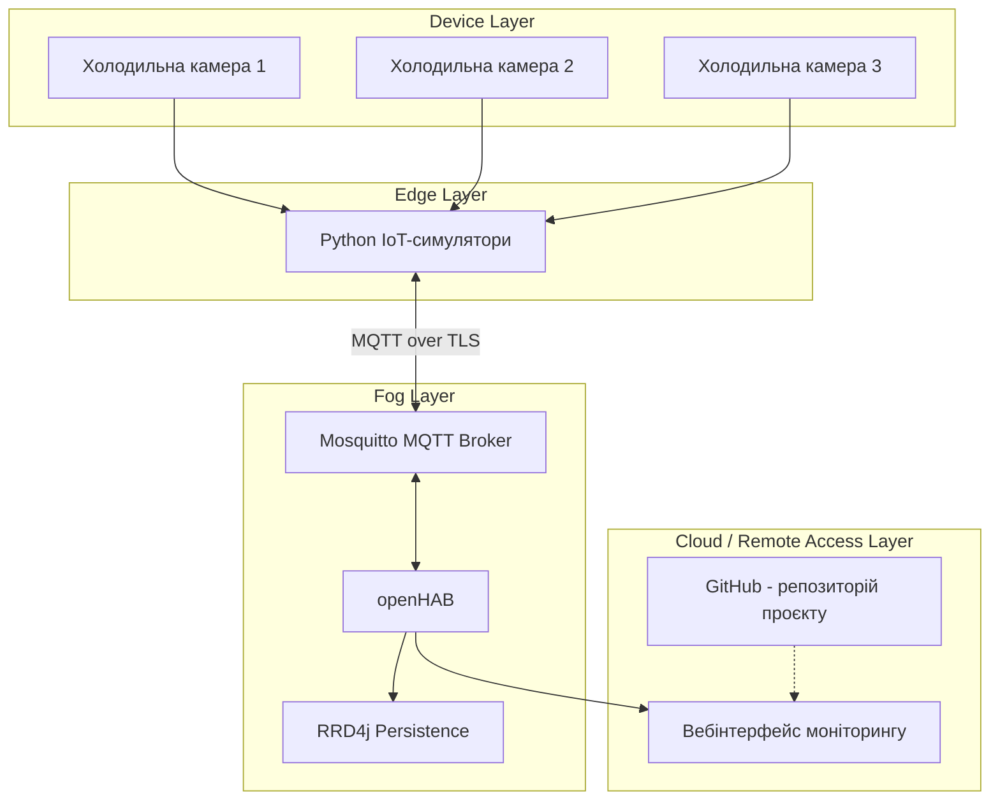
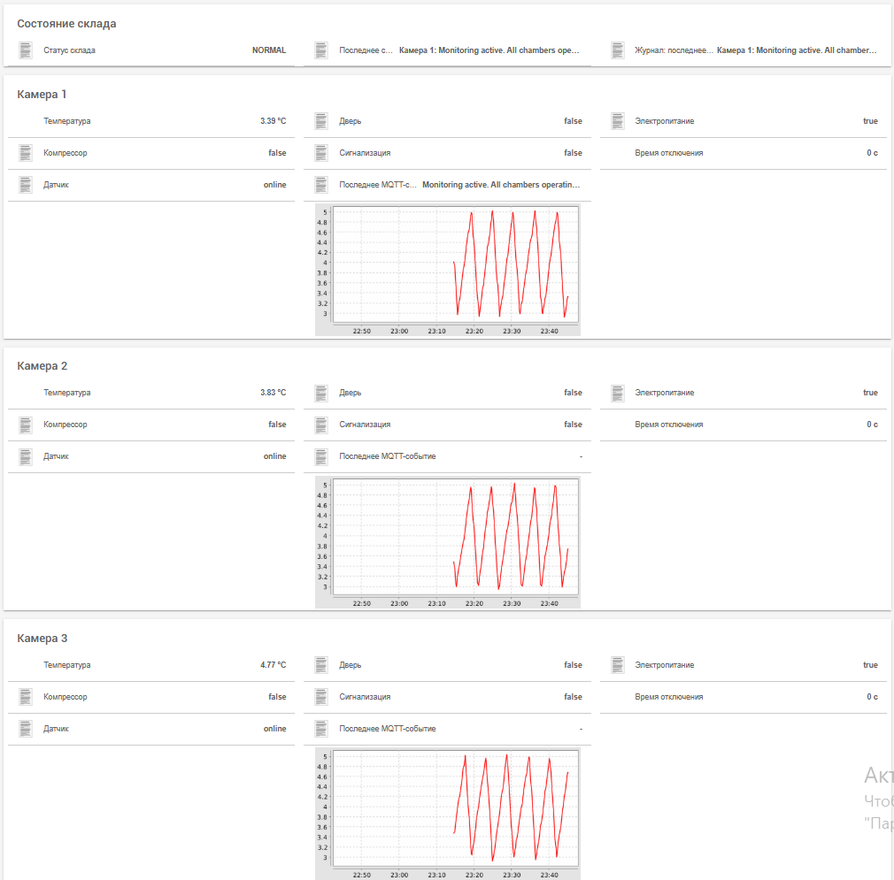
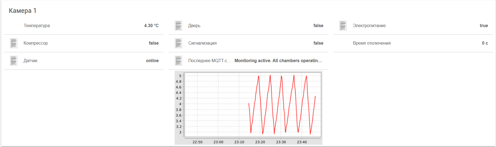
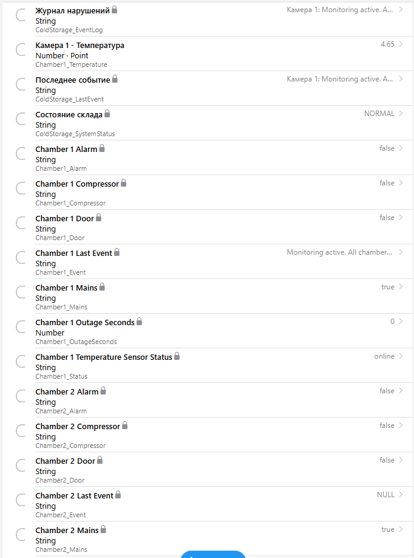
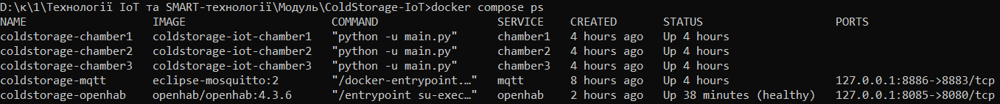
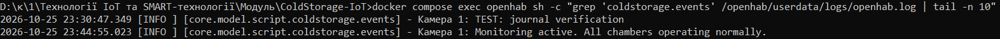

# ColdStorage-IoT

## Система моніторингу медичного холодильного складу

**ColdStorage-IoT** - навчальний IoT-проєкт для моніторингу трьох холодильних камер медичного складу. Система імітує роботу датчиків і виконавчих пристроїв, передає дані через захищене MQTT-з'єднання та відображає стан обладнання в openHAB.

Проєкт розроблено для варіанта 6 модульної контрольної роботи.

## 1. Мета проєкту

Мета проєкту - реалізувати систему моніторингу холодильного обладнання, яка дозволяє:

- Контролювати температуру трьох холодильних камер.
- Відстежувати стан дверей та електроживлення.
- Керувати компресором і сигналізацією.
- Виявляти аварійні ситуації.
- Фіксувати події та порушення.
- Переглядати поточні показники й графіки температури.
- Захищати обмін даними за допомогою MQTT over TLS.

Допустимий температурний діапазон: **від +2 °C до +8 °C**.

## 2. Використані технології

| Технологія | Призначення |
|---|---|
| Python | Симуляція IoT-пристроїв |
| paho-mqtt | MQTT-клієнт симуляторів |
| Eclipse Mosquitto | MQTT-брокер |
| TLS | Шифрування MQTT-з'єднань |
| MQTT ACL | Розмежування доступу до топіків |
| openHAB 4.3.6 | Моніторинг та автоматизація |
| RRD4j | Збереження історії температур |
| Docker Compose | Запуск компонентів системи |
| Git | Контроль версій |

## 3. Архітектура системи

Система побудована за чотирирівневою IoT-архітектурою.



**Device Layer** - логічні холодильні камери з датчиками температури, дверей, живлення та виконавчими пристроями.

**Edge Layer** - Python-симулятори, які формують телеметрію, обробляють команди та імітують роботу холодильного обладнання.

**Fog Layer** - локальний MQTT-брокер Mosquitto, openHAB і сервіс збереження історії RRD4j. Автоматизація та обробка подій виконуються локально.

**Cloud / Remote Access Layer** - рівень доступу до результатів моніторингу та зберігання вихідного коду. У поточній реалізації вебінтерфейс openHAB працює локально; окремий хмарний сервер не розгортається.

### Чому використано Edge та Fog

Обробка показників на рівні Edge дозволяє моделювати поведінку пристроїв без фізичного обладнання.

Fog-рівень забезпечує локальну обробку MQTT-повідомлень, виконання правил і збереження історії без залежності від зовнішнього хмарного сервісу.

## 4. Структура проєкту

```text
ColdStorage-IoT/
├── docker-compose.yml
├── .env.example
├── .gitignore
├── README.md
├── AI_USAGE.md
├── mqtt/
│   ├── config/
│   └── certs/
├── simulator/
│   ├── Dockerfile
│   ├── requirements.txt
│   └── main.py
└── openhab/
    ├── conf/
    │   ├── things/
    │   ├── items/
    │   ├── rules/
    │   ├── sitemaps/
    │   └── persistence/
    ├── userdata/
    └── addons/
```

Деякі каталоги містять локальні робочі дані або секрети та не повинні повністю додаватися до Git.

## 5. MQTT-топіки

Загальна структура:

`coldstorage/<chamber>/<device>/<type>`

де:

- `chamber` - `chamber1`, `chamber2` або `chamber3`;
- `device` - назва датчика або пристрою;
- `type` - тип повідомлення.

| MQTT-топік | Призначення |
|---|---|
| `coldstorage/chamber1/temperature/telemetry` | Температура камери |
| `coldstorage/chamber1/temperature/status` | Стан підключення датчика |
| `coldstorage/chamber1/door/telemetry` | Стан дверей |
| `coldstorage/chamber1/mains/telemetry` | Електроживлення та тривалість відключення |
| `coldstorage/chamber1/compressor/set` | Команда компресору |
| `coldstorage/chamber1/compressor/state` | Підтверджений стан компресора |
| `coldstorage/chamber1/alarm/set` | Команда сигналізації |
| `coldstorage/chamber1/alarm/state` | Стан сигналізації |
| `coldstorage/chamber1/events/telemetry` | Події та порушення |

Для другої та третьої камер використовується аналогічна структура з `chamber2` і `chamber3`.

### Приклади повідомлень

Температура:

```json
{
  "ts": "2026-10-25T20:00:00Z",
  "value": 4.2,
  "unit": "C"
}
```

Стан датчика:

```json
{
  "ts": "2026-10-25T20:00:00Z",
  "status": "online"
}
```

Електроживлення:

```json
{
  "ts": "2026-10-25T20:00:00Z",
  "value": false,
  "outage_seconds": 120
}
```

У повідомленнях використовується часова мітка `ts`.

## 6. Логіка роботи холодильних камер

Кожна камера має:

- Датчик температури.
- Датчик відкриття дверей.
- Контроль електроживлення.
- Контроль роботи компресора.
- Керування компресором.
- Керування сигналізацією.
- Стан доступності температурного датчика.

### Температура

Нормальний діапазон: **+2...+8 °C**.

У разі тривалого виходу температури за допустимі межі система формує аварійну подію та активує сигналізацію.

Порогова тривалість порушення: понад 5 хвилин.

### Двері

- Понад 2 хвилини у відкритому стані - попередження.
- Понад 5 хвилин - аварійна подія.

### Електроживлення

Після втрати живлення система формує попередження з рекомендацією не відкривати двері холодильних камер.

У телеметрії передається тривалість відключення електроживлення.

### Компресор

Симулятор відтворює циклічну роботу компресора залежно від температури камери.

### Доступність датчиків

Використовується механізм MQTT Last Will and Testament (LWT), який дозволяє повідомити про втрату підключення пристрою.

Повідомлення про стан датчиків передаються з використанням retained-повідомлень.

## 7. Безпека

### MQTT over TLS

Для MQTT-брокера налаштовано TLS-з'єднання з використанням власного центру сертифікації (CA).

Внутрішній порт брокера: `8883`.

Локальний порт на хост-комп'ютері: `8886`.

### Автентифікація та авторизація

У системі використовуються:

- Вимкнений анонімний доступ.
- Окремі облікові записи для IoT-пристроїв.
- Окремий обліковий запис openHAB.
- ACL-правила доступу до MQTT-топіків.
- Принцип мінімально необхідних привілеїв.

Кожен симулятор повинен мати доступ лише до топіків своєї камери.

### Захист секретів

Паролі, приватні ключі, локальні файли конфігурації з обліковими даними та робочі дані openHAB не призначені для публікації в Git.

Для прикладу налаштування середовища використовується `.env.example`.

## 8. Аналіз загроз STRIDE

| Категорія | Загроза | Захист |
|---|---|---|
| Spoofing | Підключення стороннього MQTT-клієнта під виглядом пристрою | Автентифікація користувачів |
| Tampering | Зміна команд або телеметрії під час передавання | TLS |
| Repudiation | Заперечення факту виникнення аварійної події | Журнали подій openHAB |
| Information Disclosure | Перехоплення показників та команд | Шифрування MQTT-трафіку |
| Denial of Service | Перевантаження MQTT-брокера повідомленнями | Локальне розгортання та обмеження доступу |
| Elevation of Privilege | Спроба керування чужою камерою | ACL з розмежуванням прав |

Використані заходи знижують ризики, але не гарантують повного захисту від усіх атак. Зокрема, для промислового розгортання потрібні додаткові обмеження трафіку, моніторинг і резервування.

## 9. Порівняння протоколів

| Протокол | Особливості | Доцільність |
|---|---|---|
| MQTT | Модель publish/subscribe, невеликі повідомлення | Обраний для проєкту |
| HTTP | Модель запит-відповідь | Зручний для REST API |
| CoAP | Легкий протокол для обмежених пристроїв | Можлива альтернатива |
| Zigbee | Бездротова мережа малої потужності | Підходить для фізичних датчиків |
| LoRaWAN | Передавання невеликих обсягів даних на великі відстані | Доцільний для розподілених об'єктів |

MQTT обрано через підтримку publish/subscribe, QoS, retained-повідомлень, LWT і TLS.

## 10. Запуск проєкту

### Вимоги

- Docker Desktop із підтримкою Docker Compose.
- Доступ до локальних портів `8085` і `8886`.
- Наявність підготовлених конфігурацій MQTT та TLS-сертифікатів.

### Підготовка

Перед першим запуском необхідно створити локальні файли середовища, сертифікати TLS і облікові дані MQTT відповідно до конфігурації проєкту.

Секрети не повинні зберігатися у відкритому репозиторії.

### Запуск контейнерів

```cmd
docker compose up -d
```

### Перевірка контейнерів

```cmd
docker compose ps
```

### Перегляд журналів

```cmd
docker compose logs --tail=100
```

### Вебінтерфейс

Основна сторінка openHAB:

http://localhost:8085

Панель моніторингу ColdStorage:

http://localhost:8085/basicui/app?sitemap=coldstorage

## 11. Автоматизація openHAB

У системі використовуються правила для:

1. Контролю температури холодильних камер.
2. Реагування на тривале відкриття дверей.
3. Виявлення втрати електроживлення.
4. Реєстрації повідомлень про події.

Правила реалізовано за допомогою openHAB Rules DSL.

## 12. Моніторинг та історія

У вебінтерфейсі відображаються:

- Температура кожної камери.
- Стан дверей.
- Стан електроживлення.
- Стан компресора.
- Стан сигналізації.
- Тривалість відключення живлення.
- Доступність температурного датчика.
- Останнє повідомлення про подію.
- Графік температури.

Для збереження історії числових показників використовується RRD4j Persistence.

Повідомлення правил записуються до журналу openHAB. Поле журналу на панелі наразі показує останню подію.

## 13. Тестування

Для перевірки системи передбачено такі сценарії:

| Тест | Очікуваний результат |
|---|---|
| Нормальна робота камер | Температури в межах +2...+8 °C |
| Відкриття дверей понад 2 хв | Попередження |
| Відкриття дверей понад 5 хв | Аварійна подія |
| Температура поза діапазоном понад 5 хв | Сигналізація |
| Відключення електроживлення | Попередження та таймер |
| Втрата MQTT-з'єднання | Повідомлення LWT |
| Керування виконавчим пристроєм | Оновлення відповідного стану |
| Збереження температур | Поява історії на графіку |
| Реєстрація події | Оновлення останнього повідомлення |

Частину перевірок можна виконувати за допомогою симуляторів, Docker logs, MQTT-повідомлень і REST API openHAB.

## 14. Скріншоти

### 14.1. Загальний стан холодильного складу



### 14.2. Графіки температур



### 14.3. Аварійний сценарій



### 14.4. MQTT та Docker



### 14.5. Журнал подій



*Зображення необхідно додати до каталогу `screenshots` після фінальної перевірки системи.*

## 15. Використання ШІ

Під час роботи над проєктом ChatGPT використовувався для пояснення принципів MQTT, прикладів коду, аналізу конфігурацій і пошуку технічних помилок.

Детальніше використання ШІ описано у файлі [AI_USAGE.md](AI_USAGE.md).

## 16. Висновок

У проєкті ColdStorage-IoT реалізовано модель системи моніторингу трьох медичних холодильних камер із передаванням телеметрії через MQTT over TLS.

Система використовує Python-симулятори, Mosquitto, openHAB та RRD4j для відображення поточного стану обладнання, виконання правил автоматизації та збереження температурних показників.

Проєкт демонструє застосування багаторівневої IoT-архітектури, механізмів безпеки MQTT і локального моніторингу холодильного обладнання.